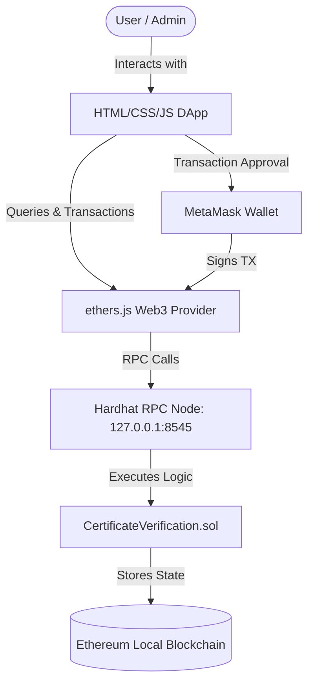
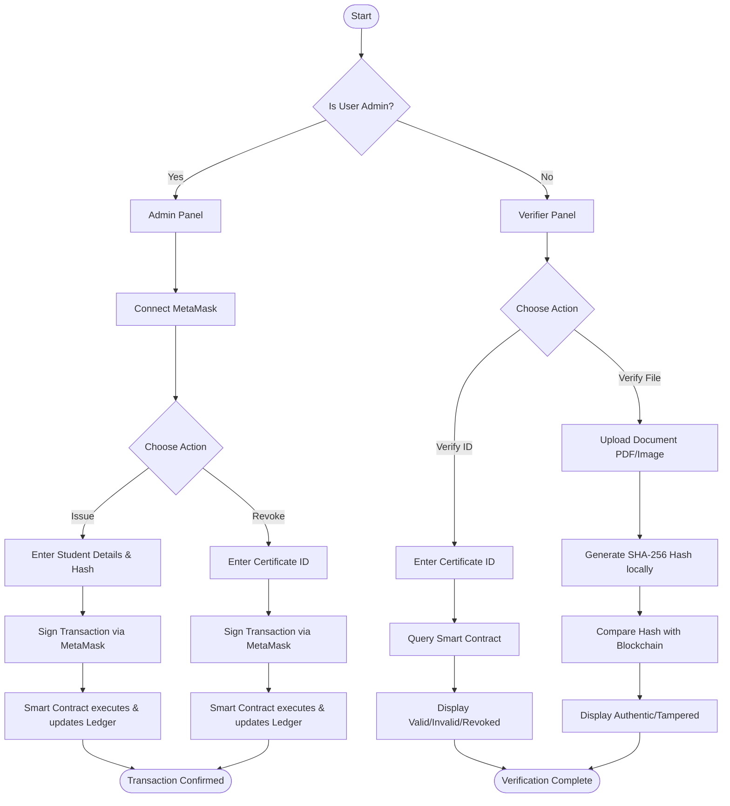

---
# [COLLEGE NAME]
# [DEPARTMENT NAME]

## MINI PROJECT REPORT

**Title:** 
Blockchain Certificate Verification System

**Project Guide:** 
[ACTUAL GUIDE NAME IF AVAILABLE]

**Project Domain:** 
Blockchain technology in academic credential management

**Academic Year:** 
[ACADEMIC YEAR]

**Students:** 
[ACTUAL STUDENT NAMES / ROLL NUMBERS IF AVAILABLE]

---

## ABSTRACT

Traditional paper-based and digitally-issued certificates are highly vulnerable to forgery, tampering, and fraudulent verification. Organizations that rely on centralized databases are exposed to single points of failure, data breaches, and manipulation by insiders. Employers and institutions cannot easily verify the authenticity of certificates without contacting the issuing authority directly, a slow, inefficient, and sometimes unreliable process.

This project proposes a Blockchain-based Certificate Verification System that leverages the immutability and transparency of the Ethereum blockchain to store and verify certificate records. Certificate data is hashed using SHA-256 and stored on the blockchain via a Solidity smart contract. Any third party can verify a certificate's authenticity instantly without needing to trust a central authority. 

The architecture consists of a smart contract written in Solidity deployed on a local Hardhat Ethereum network. The decentralized application (DApp) frontend is built with HTML, CSS, and vanilla JavaScript (ES6+), communicating with the blockchain via the ethers.js library. MetaMask is integrated for wallet management and transaction authorization. Important features include certificate issuance, certificate revocation (by admin only), instant verification by certificate ID, and file-based cryptographic hash verification to detect document tampering. 

Testing the system confirmed successful operations for certificate issuance, accurate retrieval of data, prevention of duplicate certificates, access control enforcement for admins, and cryptographic file verification. The final outcome is a robust, decentralized prototype that eliminates the dependency on centralized databases and provides a trustless, transparent mechanism for credential management.

## TABLE OF CONTENTS

1. **Chapter 1 – Introduction**
   1.1 Overview / Background
   1.2 Problem Statement
   1.3 Objectives
   1.4 Scope of the Project
2. **Chapter 2 – Literature Survey / Existing System**
   2.1 Existing System / Traditional Approach
   2.2 Drawbacks of Existing System
   2.3 Proposed Solution
3. **Chapter 3 – System Requirements & Design**
   3.1 Hardware and Software Requirements
   3.2 System Architecture
   3.3 Use Case / System Flow
   3.4 Detailed System/Module Design
4. **Chapter 4 – Implementation**
   4.1 Technology Stack Used
   4.2 Core Implementation
   4.3 Frontend / Blockchain Integration
   4.4 Deployment Details
5. **Chapter 5 – Testing & Results**
   5.1 Test Cases
   5.2 Output / Results
   5.3 Screenshots
6. **Chapter 6 – Conclusion and Future Scope**
   6.1 Conclusion
   6.2 Limitations
   6.3 Future Enhancements
7. **References**
8. **Appendix**
   A.1 Source Code / GitHub
   A.2 Important Screenshots
   A.3 Additional Technical Details

## CHAPTER 1 – INTRODUCTION

### 1.1 Background / Overview
Academic credentials and certificates are crucial documents that validate an individual's educational qualifications and skills. In the traditional educational ecosystem, institutions issue paper certificates or digital copies (like PDFs) to students upon graduation or course completion. However, this domain faces significant challenges regarding the authenticity and verification of these credentials. Fraudulent certificates are a widespread issue, leading to reputational damage for educational institutions and financial losses for employers.

Blockchain technology introduces a paradigm shift in data management. A blockchain is a distributed, decentralized ledger where data is stored in blocks that are cryptographically linked together. Key properties of blockchain include decentralization (no single entity controls the network), transparency (all participants can view the ledger), and immutability (once data is written to the blockchain, it cannot be altered or deleted). Smart contracts are self-executing programs stored on the blockchain that run when predetermined conditions are met. By utilizing these properties, a blockchain can act as an incorruptible digital ledger for issuing and verifying academic certificates.

### 1.2 Problem Statement
Traditional paper-based and digitally-issued certificates are highly vulnerable to forgery, tampering, and fraudulent verification. Organizations that rely on centralized databases are exposed to single points of failure, data breaches, and manipulation by insiders. Employers and institutions cannot easily verify the authenticity of certificates without contacting the issuing authority directly, a process that is slow, inefficient, and sometimes unreliable. There is a need for a decentralized, transparent, and cryptographically secure system to manage and verify academic credentials instantly.

### 1.3 Objectives
The primary objectives of this project are:
1. Develop a decentralized platform for issuing academic certificates.
2. Implement SHA-256 hashing to protect certificate integrity and detect document tampering.
3. Enable instant, trustless certificate verification by any third party using the blockchain.
4. Allow authorized administrators to revoke invalid or incorrectly issued certificates.
5. Provide file-based verification to ensure the physical or digital document matches the on-chain record.
6. Eliminate dependency on centralized databases and intermediaries for credential verification.

### 1.4 Scope of the Project
**Current Implemented Scope:**
The current prototype allows a single authorized administrator (the smart contract owner) to issue certificates, storing details like student name, course, issue date, and a SHA-256 hash on a local Ethereum network (Hardhat). It provides a frontend interface for the admin to issue/revoke certificates and for the public to verify certificates by ID or file upload. It uses MetaMask for transaction signing.

**Prototype Limitations:**
The system currently runs on a local Hardhat test network, meaning data is not persistently available globally unless the node is running. Only one admin is supported. Certificate files themselves are not stored (e.g., on IPFS); only their hashes are recorded on-chain.

**Outside Current Scope:**
Production deployment to Ethereum Mainnet, multi-institution access control, mobile application development, and integration with decentralized storage networks like IPFS for storing the actual certificate files are outside the scope of the current implementation.

## CHAPTER 2 – LITERATURE SURVEY / EXISTING SYSTEM

### 2.1 Existing System / Traditional Approach
In the existing ecosystem, educational institutes issue physical paper certificates or digital PDFs (sometimes signed with standard PKI certificates). The records of these certificates are maintained in centralized relational databases owned and operated by the issuing institution. When an employer or third party needs to verify a certificate, they typically must contact the university's registrar office via email, phone, or a proprietary university portal, waiting for a manual confirmation.

### 2.2 Drawbacks of Existing System
1. **Single Point of Failure:** Centralized databases are vulnerable to hacking, server crashes, and data loss.
2. **Vulnerability to Forgery:** Paper certificates and standard PDFs can be easily forged or manipulated using modern editing software.
3. **Inefficient Verification:** Manual verification involves significant time delays, sometimes taking weeks, which slows down recruitment processes.
4. **Insider Manipulation:** Database administrators or malicious insiders can alter academic records without leaving a transparent audit trail.
5. **Lack of Transparency:** Third parties cannot independently verify the authenticity of the records without trusting the central authority's current database state.
6. **High Administrative Costs:** Maintaining verification departments and secure printing facilities incurs significant ongoing costs for educational institutions.

### 2.3 Proposed Solution
This project proposes a Blockchain-based Certificate Verification System. Instead of a centralized database, certificate records and cryptographic hashes are stored on the Ethereum blockchain via a Solidity smart contract. The decentralized nature of the blockchain ensures that no single entity can manipulate the records once they are issued. The system provides instantaneous verification for employers without needing manual intervention from the university.

**Comparison Table: Existing System vs. Proposed System**

| Feature | Existing System | Proposed System |
| :--- | :--- | :--- |
| **Architecture** | Centralized database | Decentralized blockchain ledger |
| **Data Integrity** | Vulnerable to database tampering | Immutable once recorded |
| **Verification Speed** | Slow, often requires manual checks | Instantaneous and automated |
| **Security** | Relies on perimeter security & firewalls | Cryptographically secured via SHA-256 |
| **Transparency** | Opaque to third parties | Fully transparent and publicly verifiable |
| **Document Forgery** | High risk, hard to detect | Instantly detected via hash mismatch |
| **Ownership of Infrastructure** | Solely owned by issuing institution | Distributed across the blockchain network |

## CHAPTER 3 – SYSTEM REQUIREMENTS & DESIGN

### 3.1 Hardware Requirements

| Component | Minimum Specification | Recommended Specification |
| :--- | :--- | :--- |
| **Processor** | Intel Core i3 / AMD Ryzen 3 | Intel Core i5 / AMD Ryzen 5 or higher |
| **RAM** | 4 GB | 8 GB or higher |
| **Storage** | 500 MB Free Space | 1 GB Free Space (SSD preferred) |
| **Network** | Internet connection (for NPM/MetaMask) | Broadband connection |

### 3.2 Software Requirements

| Category | Technology/Tool | Purpose |
| :--- | :--- | :--- |
| **Smart Contract** | Solidity (0.8.19) | Writing on-chain certificate logic |
| **Blockchain Network**| Ethereum (Hardhat Local) | Local decentralized testing ledger |
| **Dev Framework** | Hardhat (2.x) | Compile, deploy, and test smart contracts |
| **Frontend** | HTML / CSS / JavaScript | Developing the DApp user interface |
| **Web3 Library** | ethers.js (5.x) | Connecting frontend to the blockchain |
| **Wallet** | MetaMask Extension | Browser-based Ethereum wallet and signer |
| **Hashing Engine** | Web Crypto API | Computing SHA-256 certificate file hashes |
| **Runtime Environment**| Node.js (v16+) | Running Hardhat and local HTTP server |
| **Code Editor** | Visual Studio Code | Development and debugging |

### 3.3 System Architecture

**Architecture Component Explanation:**
- **Frontend DApp:** The web interface where the Admin issues/revokes certificates and Verifiers check authenticity. Built with vanilla HTML/CSS/JS.
- **MetaMask:** Acts as the authentication and transaction signing layer. Admins use their MetaMask account (linked to the contract owner address) to authorize issuance and revocation.
- **ethers.js:** A JavaScript library that facilitates communication between the Frontend DApp and the Ethereum network. It handles ABI encoding, event listening, and sending signed transactions.
- **Smart Contract (Solidity):** Contains the core business logic (`issueCertificate`, `verifyCertificate`, `revokeCertificate`). It dictates the rules of who can do what.
- **Blockchain Ledger:** The underlying Hardhat local Ethereum node that acts as the immutable database storing the `Certificate` structs and emitting events. Note that no external traditional database (like MySQL or MongoDB) is used.

### 3.4 System Flow / Use Case

### 3.5 Detailed System/Module Design

**1. Authentication & Wallet Integration Module**
- **Purpose:** Connect the user's Ethereum wallet to the DApp to authorize state-changing transactions.
- **Input:** User clicking "Connect Wallet".
- **Processing:** Requests account access via `window.ethereum.request({ method: 'eth_requestAccounts' })`.
- **Output:** The user's wallet address is displayed, and the Web3 provider is initialized.
- **Technologies:** JavaScript, MetaMask API, ethers.js.

**2. Certificate Issuance Module (Admin Only)**
- **Purpose:** Issue a new certificate and store its cryptographic representation on the blockchain.
- **Input:** Certificate ID, Student Name, Email, Course, Institute, Date, and SHA-256 File Hash.
- **Processing:** Validates inputs, checks for uniqueness, and constructs a transaction to call the `issueCertificate` function on the smart contract.
- **Output:** Transaction hash and confirmation message. Blockchain state is updated with a new `Certificate` struct.
- **Technologies:** HTML Forms, ethers.js, Solidity (`issueCertificate` function).

**3. Certificate Verification Module (Public)**
- **Purpose:** Allow anyone to verify a certificate's status and details using its unique ID.
- **Input:** Certificate ID.
- **Processing:** Calls the read-only `getCertificate` and `verifyCertificate` functions on the smart contract. No gas fees are required.
- **Output:** Displays the certificate details (Name, Course, Date) and status (Valid, Invalid, Revoked).
- **Technologies:** JavaScript, ethers.js, Solidity (`verifyCertificate` function).

**4. Cryptographic File Integrity Module**
- **Purpose:** Verify that a physical/digital document has not been altered since issuance.
- **Input:** Uploaded file (PDF/Image).
- **Processing:** The frontend uses the browser's Native Web Crypto API to compute the SHA-256 hash of the uploaded file locally. It then queries the blockchain to see if this hash matches the `certificateHash` stored for that ID.
- **Output:** Indicates whether the file is "Authentic" or "Tampered".
- **Technologies:** JavaScript Web Crypto API (`crypto.subtle.digest`), ethers.js.

**5. Certificate Revocation Module (Admin Only)**
- **Purpose:** Invalidate a previously issued certificate (e.g., due to an error or disciplinary action).
- **Input:** Certificate ID.
- **Processing:** Verifies admin ownership, checks if the certificate exists, and updates the `revoked` boolean flag in the smart contract.
- **Output:** Transaction confirmation and updated certificate status.
- **Technologies:** Solidity (`revokeCertificate` function), ethers.js.

## CHAPTER 4 – IMPLEMENTATION

### 4.1 Technology Stack Used

| Technology | Role in Project |
| :--- | :--- |
| **Solidity** | Programming language used for writing the `CertificateVerification.sol` smart contract. |
| **Ethereum (Hardhat)**| Local blockchain environment used for deploying and testing the contract without real gas fees. |
| **ethers.js** | Web3 library used in the frontend to interact with the Ethereum node and smart contract. |
| **MetaMask** | Browser extension used for managing accounts, private keys, and signing transactions securely. |
| **Web Crypto API** | Native browser API used to generate SHA-256 hashes of files on the client side without uploading them to a server. |
| **HTML/CSS/JS** | Core web technologies used to build the responsive user interface (Admin and Verifier panels). |

### 4.2 Core Implementation

The core logic resides in the Solidity smart contract: `CertificateVerification.sol`.

**Key State Variables and Data Structures:**
- `struct Certificate`: Holds the certificate properties (`certificateId`, `studentName`, `studentEmail`, `courseName`, `instituteName`, `issueDate`, `certificateHash`, `issuer`, `revoked`, `exists`).
- `mapping(string => Certificate) private certificates`: The primary data store linking a unique ID string to the Certificate struct.
- `address public owner`: Stores the address of the deployer, ensuring only they have admin rights.

**Modifiers:**
- `onlyOwner`: Requires `msg.sender == owner`, restricting access to critical functions.

**Main Functions:**
1. **`issueCertificate(...)`**: Validates inputs to ensure they are not empty, checks that the `certificateId` doesn't already exist, populates the struct, saves it to the mapping, and emits the `CertificateIssued` event. Only callable by the `owner`.
2. **`revokeCertificate(string memory _certificateId)`**: Looks up the certificate, ensures it exists and isn't already revoked, sets `revoked = true`, and emits `CertificateRevoked`.
3. **`getCertificate(...)` & `verifyCertificate(...)`**: `view` functions that return the struct details or a formatted status message based on the `exists` and `revoked` flags. These cost no gas to execute.

### 4.3 Frontend / Blockchain Integration

The frontend operates entirely as a static client-side application, eliminating the need for a traditional backend server (like Node.js/Express or Python/Django).

**Integration Flow:**
1. **Provider Initialization:** The app detects the `window.ethereum` object injected by MetaMask.
2. **Contract Instantiation:** Using `ethers.js`, the app connects to the deployed contract using its Address and ABI (Application Binary Interface).
3. **Read Operations (Verification):** When verifying, the frontend calls `contract.verifyCertificate(id)`. This is sent directly to the local Hardhat RPC node, and the result is returned instantly.
4. **Write Operations (Issuance):** When issuing, the app gets a `Signer` from MetaMask. It calls `contract.issueCertificate(...)`. MetaMask intercepts this, pops up a UI asking the user to confirm the transaction and pay the (test) gas fee. Once confirmed, the signed transaction is broadcast to the network. The app waits for the transaction receipt to confirm success.

### 4.4 Deployment Details

The deployment process utilizes the Hardhat development framework.

- **Network:** Hardhat Local Node (Chain ID: 31337). This creates a temporary local blockchain with 20 funded test accounts.
- **Contract Deployment:** A script (`scripts/deploy.js`) compiles the Solidity code and deploys it to the local network using the first test account (which becomes the `owner`).
- **Frontend Deployment:** The HTML/CSS/JS files are served using a local HTTP server (like VS Code Live Server or Python HTTP server) on port `5500` or `8080`.
- **Environment Configuration:** A `.env` file stores the local private key (`0xac0974bec39a17e36ba4a6b4d238ff944bacb478cbed5efcae784d7bf4f2ff80`), RPC URL, and Chain ID used by Hardhat. *Security Note: This is a publicly known test key and is strictly for local development.*

## CHAPTER 5 – TESTING & RESULTS

### 5.1 Test Cases

The smart contract was tested extensively using Hardhat and Chai. Below are the core test scenarios validated in the system.

| Test ID | Test Scenario | Input/Action | Expected Result | Actual Result | Status |
| :--- | :--- | :--- | :--- | :--- | :--- |
| **TC-01** | Contract Deployment | Deploy contract | Owner is set correctly to deployer | Owner matched deployer | ✅ Pass |
| **TC-02** | Valid Certificate Issuance | Admin issues new certificate with valid data | Transaction succeeds, event emitted | Successfully added to chain | ✅ Pass |
| **TC-03** | Unauthorized Issuance | Non-admin tries to issue a certificate | Transaction reverts with access error | Reverted as expected | ✅ Pass |
| **TC-04** | Duplicate ID Rejection | Admin issues cert with existing ID | Transaction reverts with duplicate error | Reverted as expected | ✅ Pass |
| **TC-05** | Empty Field Rejection | Admin issues cert with missing fields | Transaction reverts with validation error | Reverted as expected | ✅ Pass |
| **TC-06** | Verify Valid Certificate | Verifier queries existing, valid ID | Returns Valid status and correct data | Correct details returned | ✅ Pass |
| **TC-07** | Verify Invalid Certificate| Verifier queries non-existent ID | Returns Invalid / Not Found status | Not Found returned | ✅ Pass |
| **TC-08** | Certificate Revocation | Admin revokes an existing certificate | Transaction succeeds, status updated | Marked as revoked | ✅ Pass |
| **TC-09** | Verify Revoked Cert | Verifier queries the revoked ID | Returns Revoked status | Revoked status returned | ✅ Pass |
| **TC-10** | Unauthorized Revocation | Non-admin tries to revoke a certificate | Transaction reverts with access error | Reverted as expected | ✅ Pass |
| **TC-11** | File Hash Matching | Upload unmodified original document | File hash matches blockchain hash | Authentic status shown | ✅ Pass |
| **TC-12** | File Hash Mismatch | Upload modified/tampered document | File hash does not match blockchain | Tampered status shown | ✅ Pass |

### 5.2 Results
The implementation successfully demonstrated a fully decentralized flow. 
- The smart contract reliably enforces access control, ensuring that only the designated institute admin can write data to the blockchain.
- Certificate issuance acts correctly as an append-only operation, permanently logging the data.
- The retrieval of certificate data is instantaneous and accurate.
- The cryptographic file verification using SHA-256 successfully detects even a 1-byte alteration in the uploaded certificate document, proving its effectiveness against forgery.

### 5.3 Screenshots

*(Note: Insert the corresponding screenshots from the project's actual execution here. Ensure captions match the visual context.)*

**Fig 5.1: MetaMask Wallet Connection**
*(Screenshot demonstrating the MetaMask prompt asking the user to connect their wallet to the DApp.)*

**Fig 5.2: Admin Dashboard - Issue Certificate**
*(Screenshot showing the filled-out form for issuing a new certificate with details like Student Name, Course, and Hash.)*

**Fig 5.3: MetaMask Transaction Confirmation**
*(Screenshot of the MetaMask window prompting the admin to confirm the gas fee and sign the transaction for issuance.)*

**Fig 5.4: Verifier Panel - Successful Verification**
*(Screenshot showing the search result for a valid certificate ID, displaying a green "VALID" indicator and the certificate details.)*

**Fig 5.5: Cryptographic File Hash Verification**
*(Screenshot showing the file upload section successfully confirming that the uploaded document's SHA-256 hash matches the blockchain record.)*

**Fig 5.6: Certificate Revoked Status**
*(Screenshot showing a search result for a certificate that has been revoked, displaying a red "REVOKED" warning.)*

## CHAPTER 6 – CONCLUSION AND FUTURE SCOPE

### 6.1 Conclusion
The "Blockchain Certificate Verification System" successfully demonstrates the practical application of decentralized ledger technology in solving the critical real-world problem of academic credential forgery. By replacing a vulnerable centralized database with an immutable Ethereum smart contract, the system ensures that certificates cannot be altered or fabricated once issued. The integration of SHA-256 cryptographic hashing guarantees document integrity, allowing employers to instantly verify physical or digital copies without relying on the issuing university. The prototype proved that a robust, trustless, and highly secure verification platform can be built using modern Web3 tools (Solidity, ethers.js, Hardhat).

### 6.2 Limitations
While the prototype is fully functional, it possesses certain limitations inherent to its current scope:
- **Local Network Dependency:** The system operates on a local Hardhat node. The data is transient and will be lost when the local server is shut down, making it unsuitable for real-world verification without mainnet deployment.
- **No Decentralized File Storage:** The actual certificate documents (PDFs/Images) are not stored; only their hashes are. Users must manage the physical files themselves.
- **Single Administrator:** Access control is currently limited to a single contract owner, which is impractical for large universities requiring multiple departmental admins.
- **Gas Costs:** If deployed to the Ethereum mainnet, issuing each certificate would incur real financial costs (gas fees), which could fluctuate significantly.

### 6.3 Future Enhancements
To evolve this prototype into a production-ready application, several enhancements can be implemented:
- **Testnet/Mainnet Deployment:** Deploying the smart contract to Ethereum testnets (e.g., Sepolia) or Layer-2 scaling solutions (like Polygon) to provide persistent availability while minimizing gas costs.
- **IPFS Integration:** Integrating the InterPlanetary File System (IPFS) to store the actual certificate files in a decentralized manner, linking the IPFS CID within the smart contract.
- **Role-Based Access Control (RBAC):** Implementing OpenZeppelin's AccessControl module to support multiple admin roles (Super Admin, Department Admin).
- **Batch Issuance:** Developing functionality to issue multiple certificates in a single blockchain transaction, drastically reducing operational gas costs for the institution.
- **QR Code Integration:** Automatically generating QR codes containing the certificate ID and verification URL to print on physical certificates for seamless mobile scanning.

## REFERENCES

1. Nakamoto, S. (2008). *Bitcoin: A Peer-to-Peer Electronic Cash System*. 
2. Wood, G. (2014). *Ethereum: A Secure Decentralised Generalised Transaction Ledger*. Ethereum Project Yellow Paper.
3. Solidity Documentation (v0.8.19). *Solidity - Smart Contract Programming Language*. Retrieved from https://docs.soliditylang.org/
4. Hardhat Documentation. *Ethereum development environment for professionals*. Retrieved from https://hardhat.org/docs
5. ethers.js Documentation (v5). *A complete Ethereum wallet implementation and utilities in JavaScript*. Retrieved from https://docs.ethers.org/v5/
6. Mozilla Developer Network (MDN). *Web Crypto API - crypto.subtle.digest()*. Retrieved from https://developer.mozilla.org/en-US/docs/Web/API/SubtleCrypto/digest

## APPENDIX

### A.1 Source Code / GitHub Repository
The complete source code for this project is maintained locally in the workspace directory. Key files include:
- `contracts/CertificateVerification.sol`
- `frontend/index.html` (Admin)
- `frontend/verify.html` (Verifier)
- `frontend/app.js` (Web3 Integration)
- `scripts/deploy.js`
- `test/CertificateVerification.js`

*(If hosted on GitHub, the repository link would be placed here: `https://github.com/your-username/blockchain_cerficate`)*

### A.2 Missing Screenshots to be Captured
Before final submission, ensure the following screenshots are captured from the running application and inserted into Chapter 5.3:
1. MetaMask connection prompt in the browser.
2. The "Issue Certificate" form filled with dummy data.
3. MetaMask popup showing the exact gas fee estimation during issuance.
4. The verification screen showing a green success message for a valid ID.
5. The file verification screen showing hash comparison logic.
6. The verification screen showing a red revoked status.

### A.3 Contract ABI Note
The application relies on the Application Binary Interface (ABI) generated during compilation (`artifacts/contracts/CertificateVerification.sol/CertificateVerification.json`). This ABI defines the methods (like `issueCertificate` and `verifyCertificate`) that the frontend ethers.js library calls to interact with the bytecode running on the Ethereum network.
